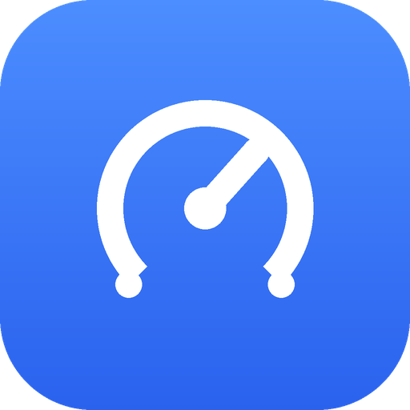
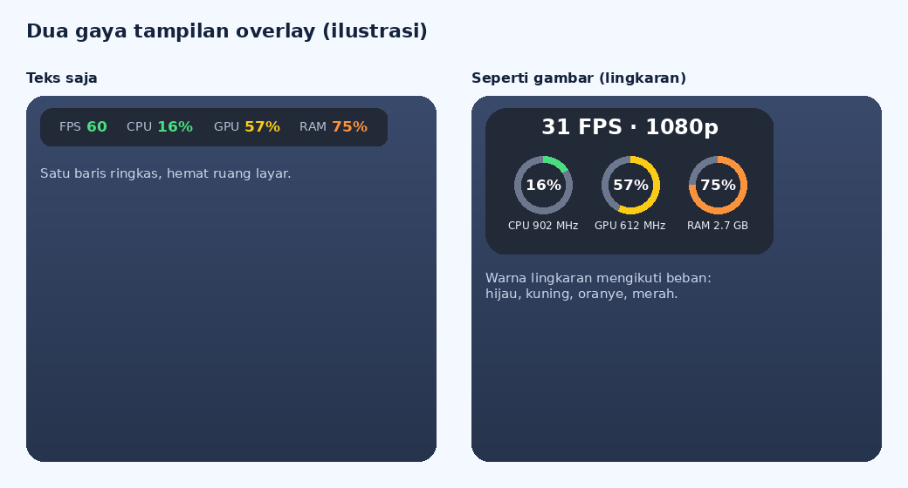

<p align="center">
  
</p>

<h1 align="center">Nex Fps Overlay</h1>

<p align="center">
  Overlay ringan untuk memantau <b>FPS, CPU, GPU, dan RAM</b> di atas game atau aplikasi pilihanmu.<br>
  Android 11 - 16 &middot; Terintegrasi Shizuku (tanpa root) &middot; <code>com.nex.fps</code>
</p>

<p align="center">
  
</p>

---

## Panduan pasang Shizuku (baca ini dulu)

Nex Fps Overlay memakai **Shizuku** untuk membaca FPS, CPU, dan GPU. Aplikasi biasa tidak boleh membaca data itu di Android modern, jadi tanpa Shizuku overlay tidak bisa mengukur. Semua langkah ini juga ada di dalam aplikasi, di kartu **Panduan pasang Shizuku** paling atas, lengkap dengan tanda centang tiap langkah yang sudah selesai.

### Langkah 1 - Pasang aplikasi Shizuku
Unduh dari <https://shizuku.rikka.app/download/> atau Google Play, lalu pasang. Pakai versi terbaru.

### Langkah 2 - Aktifkan Opsi pengembang
1. Buka **Pengaturan > Tentang ponsel**.
2. Ketuk **Nomor build** sebanyak 7 kali sampai muncul pesan "Anda sekarang pengembang".
3. Nama menu bisa berbeda tiap merek (di beberapa ponsel ada di *Informasi perangkat lunak*).

### Langkah 3 - Jalankan (Start) Shizuku lewat Debugging nirkabel
Cara ini tanpa PC dan tanpa root, tapi ponsel harus **tersambung Wi-Fi** (Wi-Fi tanpa internet atau hotspot ponsel lain juga bisa).
1. Buka **Pengaturan > Sistem > Opsi pengembang** lalu nyalakan **Debugging nirkabel**.
2. Buka aplikasi **Shizuku**, pilih mulai lewat **Debugging nirkabel**, lalu ikuti proses **pairing** (masukkan kode pairing dari notifikasi/layar Debugging nirkabel).
3. Setelah pairing berhasil, tekan **Mulai**. Status berubah menjadi *Shizuku sedang berjalan*.

> **Catatan:** pada ponsel tanpa root, Shizuku berhenti setelah ponsel restart, jadi ulangi langkah 3 setelah restart. Alternatif lain: lewat PC, jalankan
> `adb shell sh /sdcard/Android/data/moe.shizuku.privileged.api/start.sh`, atau gunakan root bila ada.

### Langkah 4 - Beri izin Shizuku ke Nex Fps Overlay
Di Nex Fps Overlay, ketuk **Beri izin**, lalu pilih **Izinkan** pada dialog Shizuku.
Bila pernah menolak permanen: Shizuku > **Aplikasi yang diizinkan** > Nex Fps Overlay > **Izinkan**.

### Langkah 5 - Izin lain
- **Tampil di atas aplikasi lain** (wajib): ketuk **Buka pengaturan** lalu aktifkan sakelar Nex Fps Overlay.
- **Notifikasi** (Android 13+): izinkan agar notifikasi layanan latar belakang tampil.

Selesai. Pilih aplikasi di daftar bawah, tekan **Mulai overlay**, lalu buka aplikasinya.

---

## Fitur

- Empat metrik, bebas dipilih satu per satu atau keempatnya: **FPS, CPU, GPU, RAM**.
- Empat pilihan posisi: **kiri atas, tengah atas, kanan atas**, dan **Bebas** (geser panel langsung dengan jari ke mana saja).
- Dua gaya tampilan:
  - **Teks saja**: satu baris ringkas.
  - **Seperti gambar**: panel dengan lingkaran indikator, warnanya mengikuti beban (hijau, kuning, oranye, merah), lengkap dengan MHz dan resolusi.
- **Per aplikasi**: overlay hanya muncul saat salah satu aplikasi yang kamu centang sedang dibuka.
- Ringan: satu perintah shell per detik, tampilan digambar langsung di Canvas, tidak mengambil sentuhan (sentuhan tembus ke game).
- Tema putih dengan biru soft modern.

## Cara pakai

1. Selesaikan panduan Shizuku di atas.
2. Pilih metrik yang ingin tampil, posisi, dan gaya.
   Untuk posisi **Bebas**: pilih *Bebas (geser sendiri)*, buka aplikasi yang dicentang, lalu geser panel overlay dengan jari ke tempat yang diinginkan. Posisi tersimpan otomatis sebagai pecahan layar, jadi tetap pas saat layar diputar.
3. Centang aplikasi atau game yang ingin dipantau.
4. Tekan **Mulai overlay**, lalu buka game. Overlay muncul otomatis dan hilang saat kamu keluar dari game.
5. Untuk berhenti, tekan **Hentikan** atau tombol *Hentikan* di notifikasi.

## Cara kerja dan batasan

| Metrik | Sumber | Catatan |
|---|---|---|
| FPS | `dumpsys SurfaceFlinger --latency <layer>` | Layer aplikasi dicari otomatis. FPS dihitung dari frame yang tampil dalam 1 detik terakhir. Tampil `--` bila layer tidak ditemukan. |
| CPU | `/proc/stat` dan `scaling_cur_freq` | Beban total dan rata-rata kecepatan inti aktif. |
| GPU | `sysfs` (Adreno `kgsl`, Mali, MediaTek) | **Tergantung perangkat.** Bila pabrikan tidak membuka datanya, tampil `--%`. |
| RAM | `ActivityManager` | Memori terpakai seluruh sistem. |

- Pada posisi kiri/tengah/kanan atas overlay **tidak bisa disentuh** (sentuhan tembus ke game), jadi tidak ada tombol minimize. Pada posisi **Bebas** panel menerima sentuhan di areanya sendiri supaya bisa digeser, sedangkan area di luar panel tetap tembus. Bila panel mengganggu kontrol game, pindah ke salah satu posisi atas.
- Jendela overlay memakai opasitas 0,8 supaya sentuhan tetap diteruskan di Android 12 ke atas.
- Aplikasi yang tidak menggambar lewat SurfaceFlinger bisa menampilkan FPS `--`.
- Proyek ini ditulis tanpa uji di perangkat fisik. Bila ada metrik yang salah di perangkatmu, buka *Issue* dan sertakan merek, tipe, dan versi Android.

## Build

### Opsi 1 - GitHub Actions (tanpa Android Studio)
1. Unggah proyek ke GitHub (lihat bagian bawah).
2. Buka tab **Actions** > *Build APK* > pilih proses terbaru > unduh artefak **NexFpsOverlay-apk**.
3. Untuk Release otomatis, buat tag: `git tag v1.0.0 && git push origin v1.0.0`. APK akan terlampir di halaman **Releases**.

### Opsi 2 - Android Studio
1. Pasang **Android Studio Narwhal (2025.1) atau lebih baru** (membawa JDK 17).
2. **File > Open** lalu pilih folder proyek ini. Biarkan IDE mengunduh Gradle 8.13 dan SDK Platform 36.
3. **Build > Build Bundle(s) / APK(s) > Build APK(s)**, atau tekan **Run** pada perangkat.

### Opsi 3 - Baris perintah
Dengan Gradle 8.13 dan JDK 17 terpasang: `gradle assembleRelease`. Untuk membuat `gradlew`: `gradle wrapper --gradle-version 8.13`.

### Ukuran APK

Build rilis sudah memakai **R8** (membuang kode tak terpakai), **shrink resources**, dan hanya menyertakan terjemahan bahasa Inggris dan Indonesia dari library. Tanpa itu APK mudah mencapai belasan MB karena Compose dan Material3 ikut utuh. Ukuran pastinya dicetak di log langkah *Siapkan APK* pada GitHub Actions.

### Tanda tangan rilis (opsional)

Secara bawaan APK rilis ditandatangani **kunci debug** supaya langsung bisa dipasang. APK seperti itu tidak cocok untuk Play Store dan tidak bisa menimpa pemasangan yang ditandatangani kunci lain. Untuk tanda tangan sendiri:

1. Buat keystore sekali saja (simpan baik-baik, jangan unggah ke repositori):
   ```bash
   keytool -genkeypair -v -keystore nex-release.jks -keyalg RSA -keysize 2048 -validity 10000 -alias nex
   base64 -w0 nex-release.jks      # salin hasilnya (di macOS: base64 -i nex-release.jks)
   ```
2. Di GitHub: **Settings > Secrets and variables > Actions > New repository secret**, buat empat secret:
   `KEYSTORE_BASE64` (hasil base64 tadi), `KEYSTORE_PASSWORD`, `KEY_ALIAS` (mis. `nex`), dan `KEY_PASSWORD`.
3. Jalankan ulang workflow. Bila keempatnya terisi, APK otomatis ditandatangani keystore itu. Bila tidak, tetap memakai kunci debug.

> Pasang ulang bila sebelumnya memakai APK bertanda tangan debug: ganti kunci berarti harus *uninstall* dulu.

## Pasang APK

1. Pindahkan `NexFpsOverlay.apk` ke ponsel lalu buka.
2. Izinkan **Pasang dari sumber ini** bila diminta.
3. Ikuti panduan Shizuku di bagian atas.

## Unggah ke GitHub

```bash
cd NexFpsOverlay
git init
git add .
git commit -m "Nex Fps Overlay v1.0.0"
git branch -M main
git remote add origin https://github.com/NAMA_KAMU/NexFpsOverlay.git
git push -u origin main
```

Buat dulu repositori kosong bernama `NexFpsOverlay` di GitHub (tanpa README bawaan). Setelah `git push`, tab **Actions** otomatis membangun APK.

## Struktur proyek

```
NexFpsOverlay/
|-- .github/workflows/build.yml      Build APK otomatis
|-- app/src/main/
|   |-- aidl/com/nex/fps/IUserService.aidl
|   |-- assets/probe_gpu.sh          Daftar jalur sysfs GPU
|   |-- java/com/nex/fps/
|   |   |-- MainActivity.kt          Layar utama + izin
|   |   |-- OverlayService.kt        Layanan latar depan + jendela overlay
|   |   |-- OverlayView.kt           Gambar overlay (teks / lingkaran)
|   |   |-- Sampler.kt               Satu perintah shell per siklus
|   |   |-- Metrics.kt               Pengurai keluaran shell
|   |   |-- ShizukuHelper.kt         Status, izin, dan eksekusi lewat Shizuku
|   |   |-- ShellService.kt          Layanan yang berjalan sebagai shell
|   |   |-- Prefs.kt                 Pengaturan
|   |   `-- ui/                      Tema dan layar Compose
|   `-- res/                         Ikon, tema, string
|-- docs/                            Gambar untuk README
`-- build.gradle.kts, settings.gradle.kts, gradle/
```

## Pemecahan masalah

| Masalah | Solusi |
|---|---|
| Tombol Mulai menolak | Selesaikan semua langkah di panduan (centang hijau). |
| Overlay tidak muncul | Pastikan aplikasi dicentang di daftar dan Shizuku masih *berjalan*. |
| FPS tampil `--` | Game belum menggambar atau layer tidak ditemukan. Tunggu beberapa detik, atau masuk ke permainan. |
| GPU tampil `--%` | Perangkat tidak membuka data GPU. Ini batasan perangkat. |
| Shizuku berhenti sendiri | Normal setelah restart pada ponsel tanpa root. Mulai lagi lewat Debugging nirkabel. |
| Overlay hilang di game tertentu | Beberapa game menutupi jendela overlay. Coba posisi atau gaya lain. |
| Posisi Bebas tidak bisa digeser | Pilih *Bebas (geser sendiri)*, lalu buka aplikasi yang dicentang. Panel hanya muncul (dan bisa digeser) saat aplikasi terpilih sedang dibuka. |

## Lisensi

MIT. Lihat [LICENSE](LICENSE). Shizuku adalah proyek [RikkaApps](https://github.com/RikkaApps/Shizuku) dengan lisensi sendiri.

## Riwayat sesi dan grafik

Tab **Riwayat** menyimpan hingga 5 sesi pengujian terakhir (mis. "28 Nov, 06:30 – Durasi 5m 12s").
Tiap sesi berisi Avg FPS, 5% Low FPS, Frametime (ms), Max Temperature (°C), dan Average Power (W)
beserta grafiknya. Ketuk kartu angka untuk mengganti grafik, sentuh/geser grafik untuk melihat nilai per detik.

- Sakelar **Rekam** menyalakan/mematikan perekaman. Sesi di bawah 10 detik tidak disimpan.
- **✕** menghapus satu sesi, **Hapus Semua** (ketuk dua kali) mengosongkan riwayat.
- Suhu = nilai tertinggi dari thermal zone dan baterai; daya = arus x tegangan baterai
  (daya total perangkat, bukan hanya SoC). Bila sensor tidak ada, grafiknya menampilkan "tidak tersedia".
